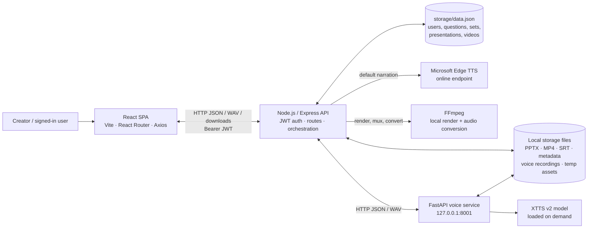
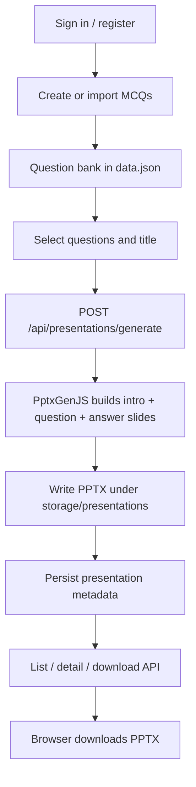

# MCQ Video Studio — Architecture, HLD and LLD

This document describes the implementation in this repository. It distinguishes working behavior from deployment or product ideas that are not implemented. The current system is a single-process MVP: React/Vite, one Node/Express API, JSON and local-file persistence, and an optional local Python/XTTS service.

## 1. System context and architecture



The browser is the presentation layer. The Express process owns authentication, account scoping, CRUD, job state, and generation orchestration. `data.json` stores structured records; generated assets and custom voice samples live on the local filesystem. Edge TTS is an external network dependency for the default narration path. Custom voice synthesis is optional and uses the FastAPI service and XTTS v2 model.

### Runtime boundaries

| Component | Current responsibility | Runtime / address |
|---|---|---|
| Client | Dashboard, question/set management, presentations, videos, narration, Voice Studio | Vite dev server `:5173`; production build in `client/dist` |
| Main API | Auth, account-scoped data, generation, downloads, job polling | Express `:5000` by default |
| Structured storage | Users and generated-resource metadata | `${STORAGE_PATH}/data.json` |
| Asset storage | Generated presentation/video artifacts, temporary render/audio files, voice samples | `${STORAGE_PATH}/...` |
| Voice API | Custom profile operations and XTTS synthesis | `127.0.0.1:8001` by default; started on demand by Node |
| External TTS | Neural voice generation for built-in voices | Edge TTS endpoint via `node-edge-tts` |

## 2. High-level design (HLD)

### Main modules

1. **Web client** — `client/src/App.jsx` supplies navigation and the shell. Pages in `client/src/pages/` provide dashboard, auth, question bank, sets, presentations, videos, narration, and voice management. The auth helper stores the JWT and user in browser local storage; API requests use the bearer token.
2. **HTTP/API layer** — `server/src/index.js` defines the Express app and endpoints. Helmet and configured CORS are enabled; JSON request bodies default to a 10 MB limit. `requireAuth` verifies JWTs and resolves the user before protected routes run.
3. **Domain services** — `pptGenerator.js` creates PPTX files; `scriptGenerator.js` creates narration segments and SRT; `videoGenerator.js` synthesizes speech and renders/muxes the video; `voiceProfiles.js` stores consented WAV samples and profile metadata; `voiceService.js` communicates with and launches the optional Python service.
4. **Persistence** — `utils/store.js` reads/writes JSON arrays for `users`, `questions`, `sets`, `presentations`, and `videos`. Files are written locally under the configured storage root.
5. **Asynchronous video orchestration** — video generation responds with HTTP 202 and a job ID. A process-local `Map` tracks queued/processing/completed/failed state, while the request handler runs generation in the background via `setImmediate`.

### HLD: primary video generation flow

```mermaid
sequenceDiagram
  actor U as User
  participant C as React client
  participant A as Express API
  participant J as In-memory job Map
  participant S as Script/video services
  participant T as Edge TTS or XTTS service
  participant F as FFmpeg
  participant D as JSON + local files

  U->>C: Choose title, questions, duration, language, voice
  C->>A: POST /api/videos/generate + Bearer JWT
  A->>A: Validate payload and account
  A->>J: Create queued job
  A-->>C: 202 { jobId, status }
  A-)S: Start generation asynchronously
  S->>S: Normalize MCQs and build narration segments
  loop question and solution segments
    S->>T: Synthesize selected voice
    T-->>S: Audio segment
  end
  S->>F: Render question/think/solution frames; mix audio
  F-->>S: MP4 output
  S->>S: Build SRT and YouTube metadata JSON
  S->>D: Save MP4, SRT, metadata; add video record
  S->>J: Set completed, progress 100, attach video
  loop until terminal job state
    C->>A: GET /api/jobs/:id
    A->>J: Read state (owner checked)
    A-->>C: status, stage, progress, video/error
  end
```

Stages reported by the current job implementation include `queued`, `narration`, `rendering`, `completed`, and `failed`. The job Map is volatile and local to one Node process: a restart loses job state, and multiple API instances do not share it. There is no durable queue/worker implementation in this repository.

### HLD: question-to-presentation flow



### HLD: custom voice lifecycle

```mermaid
sequenceDiagram
  actor U as User
  participant C as Voice Studio
  participant A as Express API
  participant P as Local voice profile store
  participant V as FastAPI / XTTS

  U->>C: Record WAV, enter name/language/topic/transcript, confirm permission
  C->>A: POST /api/voice-model/voices (audio/wav)
  A->>A: Validate bearer, consent, fields, WAV envelope
  A->>P: Save WAV + account-owned profile in voices.json
  A-->>C: Profile summary
  Note over A,V: Voice profile CRUD can work when Python is offline
  C->>A: GET /api/tts/voices
  A->>V: Ensure service / health check (may launch local process)
  V-->>A: Service availability
  A-->>C: Built-in voices + owned custom voices + availability
  C->>A: POST /api/videos/generate (custom voice selected)
  A->>V: POST /synthesize for each narration segment
  V->>V: Load XTTS v2 on first synthesis; derive conditioning from samples
  V-->>A: WAV audio
  A->>A: FFmpeg render and persist video artifacts
```

The current Node routes persist custom profile samples in the Node-managed voice catalog. The Python service reads the same catalog and files for synthesis. XTTS loads lazily on first synthesis. Profile/sample metadata is account-scoped using the user ID passed from the authenticated Node API; the Python service itself is bound to localhost by default and is not a public authenticated API.

## 3. Low-level design (LLD)

### Source map

| Path | Design role |
|---|---|
| `client/src/main.jsx`, `client/src/App.jsx` | SPA entry and navigation shell |
| `client/src/pages/*.jsx` | Page-level UI and feature workflows |
| `client/src/lib/auth.js` | Local storage session helpers |
| `client/src/lib/questionImport.js` | Client-side question import helpers |
| `server/src/index.js` | Express middleware, API routes, job lifecycle, server startup |
| `server/src/middleware/auth.js` | Bearer token verification and `req.user` population |
| `server/src/config.js` | Environment configuration and storage paths |
| `server/src/utils/store.js` | JSON-file repository for core records |
| `server/src/services/pptGenerator.js` | PPTX slide construction and file output |
| `server/src/services/scriptGenerator.js` | Narration text, localized explanations, subtitle entries/SRT |
| `server/src/services/narrationPhrases.js` | Intro phrase selection/scheduling |
| `server/src/services/videoGenerator.js` | TTS provider selection, audio staging, FFmpeg composition, artifacts |
| `server/src/services/voiceProfiles.js` | WAV sample and voice catalog CRUD on local filesystem |
| `server/src/services/voiceService.js` | Python service discovery/startup and HTTP client |
| `voice-service/main.py` | FastAPI voice/profile API, lazy XTTS model, synthesis |

### API surface

All routes are rooted at `/api`. Unless marked public, they require `Authorization: Bearer <JWT>`. Responses generally use `{ success, data }` or `{ success: false, error: { code, message } }`.

| Method and path | Auth | Purpose |
|---|---:|---|
| `GET /health` | No | API liveness |
| `POST /auth/register` | No | Create account, hash password, issue JWT |
| `POST /auth/login` | No | Verify password, issue JWT |
| `GET /questions` | Yes | List caller's questions |
| `POST /questions` | Yes | Create question |
| `POST /questions/import` | Yes | Validate/filter and bulk-import questions |
| `GET /sets` | Yes | List caller's sets |
| `POST /sets` | Yes | Create set from question IDs |
| `POST /presentations/generate` | Yes | Generate PPTX and metadata |
| `GET /presentations` | Yes | List caller's presentations |
| `GET /presentations/:id` | Yes | Get owned presentation metadata |
| `GET /presentations/:id/download` | Yes | Download owned PPTX |
| `POST /videos/generate` | Yes | Enqueue in-process video job (202) |
| `GET /videos` | Yes | List caller's videos, newest first |
| `DELETE /videos/:id` | Yes | Delete owned record and assets located in video directory |
| `GET /videos/:id/download` | Yes | Download owned MP4 |
| `GET /videos/:id/download-srt` | Yes | Download subtitles |
| `GET /videos/:id/download-metadata` | Yes | Download metadata JSON |
| `GET /jobs/:id` | Yes | Poll job; only the owner can see it |
| `GET /tts/voices` | Yes | Built-in/custom voice list and voice-service availability |
| `POST /voice-model/voices` | Yes | Create profile from WAV; requires `x-voice-consent: true` |
| `POST /voice-model/voices/:id/samples` | Yes | Add consented WAV sample |
| `DELETE /voice-model/voices/:id` | Yes | Delete caller's profile and sample files |
| `POST /tts/preview` | Yes | Return preview text/duration estimate; this route does not synthesize audio |
| `POST /narration/generate` | Yes | Return generated narration script/SRT data |

### Core records

`storage/data.json` is an aggregate document with five arrays. IDs are UUIDs; records are associated with users by `userId` and filtered by route handlers.

```text
User         { id, name, email, passwordHash, createdAt }
Question     { id, userId, question, optionA-D, correctAnswer,
               explanation, hindiExplanation, hinglishExplanation,
               subject, topic, difficulty, tags[], createdAt, updatedAt }
Set          { id, userId, name, description, questionIds[], createdAt }
Presentation { id, userId, title, filePath, fileName, questionCount, createdAt }
Video        { id, userId, title, filePath, fileName,
               subtitleFilePath, subtitleFileName,
               metadataFilePath, metadataFileName,
               questionCount, duration, audioVoice, createdAt }
```

Custom voices use `storage/voice-profiles/voices.json` and WAV files. The catalog stores `id`, `name`, `owner_id`, and `samples[]` with sample path, language, subject, and transcript. Generated video artifacts are MP4, SRT, and JSON metadata under `storage/videos`; presentations are under `storage/presentations`. Temporary render assets are also staged in the video directory and are cleaned by generation logic.

### Authentication and authorization

1. Registration requires email/password, rejects duplicate emails case-insensitively, hashes passwords with bcryptjs cost 10, stores a user, and returns a JWT valid for seven days.
2. Login finds the user by case-insensitive email and compares the password hash.
3. Protected routes call `requireAuth`: verify JWT with `JWT_SECRET`, look up the user in the JSON store, and attach it as `req.user`.
4. Data list/detail/delete handlers scope by `req.user.id`; generated job polling also checks `job.userId`.

### Video rendering detail

1. The route validates title/questions, explanation language (`english`, `hindi`, `hinglish`), and a built-in or custom voice ID.
2. `generateVideo` normalizes question/option/answer fields and produces question/solution narration segments. It uses the localized explanation field when present; otherwise it falls back to the English explanation.
3. TTS is synthesized for each question and solution. Edge TTS is the default; system voices can be selected via configuration; custom voice IDs call the local FastAPI synthesis endpoint. FFmpeg converts Edge MP3 to WAV where needed.
4. The renderer writes text assets, overlays question/think/solution screens with FFmpeg, aligns audio segments and a three-second thinking interval, and muxes the final MP4. A supported font and FFmpeg binary are required.
5. SRT timing is derived from actual segment durations where available. YouTube metadata JSON is generated locally for download; no YouTube upload or OAuth workflow is implemented in this API.
6. On success, output paths and metadata are added to `data.json`; intermediate assets are cleaned. Failure is stored in the in-memory job state.

### Configuration

| Variable | Purpose | Default |
|---|---|---|
| `PORT` | Express port | `5000` |
| `JWT_SECRET` | JWT signing secret | development fallback; set a private value |
| `CLIENT_URL` | CORS allowed origin | `http://localhost:5173` |
| `STORAGE_PATH` | Relative/absolute storage root | `./storage` |
| `TTS_PROVIDER` | Narration provider (`edge` or `system`) | `edge` |
| `TTS_VOICE` | Default English Edge voice | `en-IN-NeerjaNeural` |
| `VOICE_SERVICE_URL` | FastAPI base URL | `http://127.0.0.1:8001` |
| `VOICE_SERVICE_PYTHON` | Optional Python executable override | auto-detected by service launcher |
| `MCQ_TTS_VOICE` | Optional installed Windows system voice | unset |

See `.env.example` and `voice-service/README.md` for the full local setup. The repo's README lists Docker scaffolding, but actual container definitions should be checked before treating deployment topology as production-ready.

## 4. Operational constraints and next design steps

- JSON file persistence is suitable for a local MVP but is not a concurrent multi-instance database. Writes are whole-file synchronous writes without transaction or locking guarantees.
- Video job state is in process memory, has no durable retry/cancellation model, and cannot be polled after an API restart.
- Asset paths assume a shared local filesystem. Horizontal scaling needs object storage or a shared volume and stable asset references.
- The optional Python service has no independent user authentication; keep it loopback-only behind the Node API.
- Edge TTS requires internet access and depends on an external service. Custom XTTS requires the separate Python environment, model download, compute, disk, and review of model licensing.
- `/api/tts/preview` currently returns a text/duration estimate; it is not an audio preview.
- There is no implemented YouTube publishing flow, PostgreSQL adapter, distributed queue, or production observability layer in the routes/services documented here.

For production evolution, replace JSON persistence with a transactional database, move long-running renders to a durable queue and worker, store assets in object storage, persist job state, and add request/job correlation and structured logs. These are recommendations, not current components.
